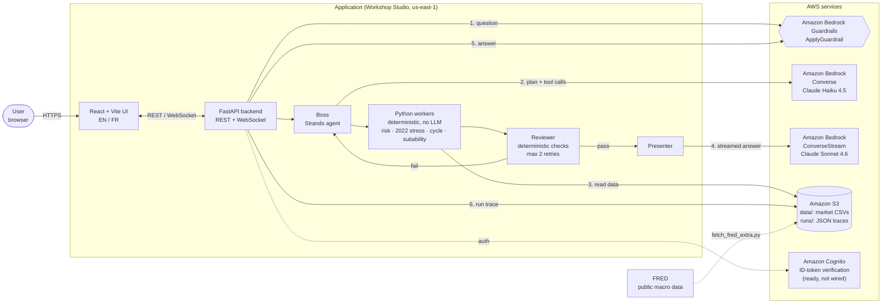

# AlphaForge AI — AWS Architecture

*Version française : [architecture-aws.fr.md](architecture-aws.fr.md)*

Region: **us-east-1**. Every LLM call goes through **Amazon Bedrock**; no other model provider is called.
AWS credentials come from the environment, never from the repo.

## Diagram

## AWS services used

| Service | Role in the solution | Where in the code |
|---|---|---|
| **Amazon Bedrock — Converse** (via Strands) | The boss (Claude Haiku 4.5, `global.` profile) reads the question, calls the workers in parallel and returns the plan | `agents/`, `agent_tools.py`, `pipeline.py` |
| **Amazon Bedrock — ConverseStream** | The presenter (Claude Sonnet 4.6) writes the answer from the worker results only; the text is streamed to the browser | `presenter.py` |
| **Amazon Bedrock Guardrails — ApplyGuardrail** | Filters the question and the answer: denied topics (personal advice to the real user, real trades), PII, content, prompt attacks; PII redacted before the trace is written | `guardrail.py` |
| **Amazon S3** | `s3://$DATA_BUCKET/data/`: prices, FX, macro (read with `DATA_SOURCE=s3`); `s3://$DATA_BUCKET/runs/<run_id>.json`: full trace of every answer, linked in the UI | `workers/data_retriever.py`, `run_trace.py` |
| **Amazon Cognito** | ID-token verification implemented and tested; no user pool configured, the server runs in dev mode | `server/auth.py` |
| **AWS Workshop Studio** (provided environment) | Runs the backend and the UI (code-server behind CloudFront) with temporary credentials | — |

## Life of a question

1. The browser sends the question to the FastAPI backend (WebSocket).
2. **Guardrail (input)**: a request for real personal advice or a trade is blocked.
3. **Bedrock / Haiku 4.5**: the boss calls the workers it needs in one parallel turn.
4. The **workers** read the data (local or **S3**) and compute every number in Python.
5. The **reviewer** checks: every asset analyzed, every number with source and period, every persona limit
   evaluated, no data after the analysis date. Fail → back to the boss (max 2).
6. **Bedrock / Sonnet 4.6** streams the answer; every number must exist in the cited step (else 1 rewrite).
7. **Guardrail (output)**, then the **trace** (step, actor, input, output summary, timestamp, durations) is
   written to **S3**.

## Design choices

- **The LLMs don't compute.** Bedrock is used for reasoning (planning) and writing; numbers come from tested
  code, so every answer can be checked.
- **Two models, two roles.** Haiku 4.5: fast and reliable for the plan. Sonnet 4.6: better writing, streamed
  (first text in 4–6 s).
- **`global.` inference profiles** for availability; boto3 client with adaptive retries (5 attempts).
- **The S3 trace is the explainability evidence**: you can replay who did what, with which data.
- **Demo mode** (`AGENT_MODE=demo`): real numbers, no Bedrock calls, for testing at no cost.

## Known limitations

- The guardrail fails open: if the API errors, the answer goes through and the trace records it.
- Conversations live in memory (lost on restart); traces stay in S3.
- No managed deployment (Lambda, ECS, AgentCore): the demo runs in the Workshop Studio environment.
- News/ESG workers (AgentCore Web Search) are designed, not built yet.
