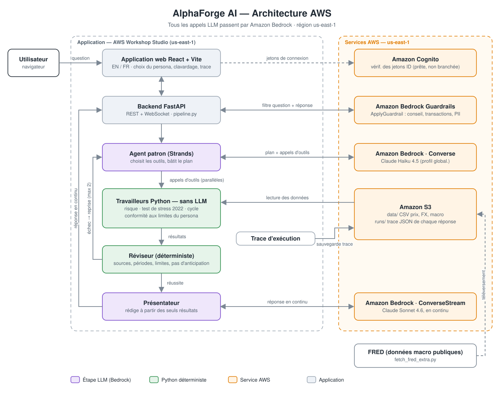

# AlphaForge AI — Architecture AWS

*English version: [architecture-aws.en.md](architecture-aws.en.md)*

Région : **us-east-1**. Tous les appels LLM passent par **Amazon Bedrock** ; aucun autre fournisseur de
modèles n'est appelé. Les identifiants AWS viennent de l'environnement, jamais du dépôt.

## Schéma

PNG: [architecture-aws.fr.png](architecture-aws.fr.png)

## Services AWS utilisés

| Service | Rôle dans la solution | Où dans le code |
|---|---|---|
| **Amazon Bedrock — Converse** (via Strands) | Claude Haiku 4.5 (profil `global.`) dans deux rôles. Le **routeur d'intention** classe chaque message et rédige la réponse courte quand il s'agit de conversation (salutations, questions sur l'assistant, explications de concepts, hors sujet). Le **patron** lit les questions d'investissement, appelle les travailleurs en parallèle et produit le plan | `router.py`, `agent_tools.py`, `pipeline.py` |
| **Amazon Bedrock — ConverseStream** | Le présentateur (Claude Sonnet 4.6) rédige la réponse à partir des seuls résultats des travailleurs ; le texte est diffusé au navigateur | `presenter.py` |
| **Amazon Bedrock Guardrails — ApplyGuardrail** | Filtre la question, la réponse d'analyse et chaque réponse de conversation : sujets refusés (conseil personnel réel, transactions réelles), PII, contenu, attaques de prompt ; caviardage des PII avant l'écriture de la trace | `guardrail.py` |
| **Amazon S3** | `s3://$DATA_BUCKET/data/` : prix, FX, macro (lecture avec `DATA_SOURCE=s3`) ; `s3://$DATA_BUCKET/runs/<run_id>.json` : trace complète de chaque réponse, liée dans l'interface | `workers/data_retriever.py`, `run_trace.py` |
| **AWS Workshop Studio** (environnement fourni) | Exécute le backend et l'interface (code-server derrière CloudFront) avec des identifiants temporaires | — |

## Parcours d'une question

1. Le navigateur envoie la question au backend FastAPI (WebSocket).
2. **Guardrail (entrée)** : si la question demande un conseil personnel réel ou une transaction, elle est bloquée.
3. **Routeur d'intention** (règles d'abord, puis **Bedrock / Haiku 4.5**) : une salutation, une question sur
   l'assistant, une question de concept (« que veut dire volatilité? ») ou un message hors sujet reçoit une
   réponse courte rédigée par Haiku, vérifiée par le code (aucun chiffre, `%` ni nom d'actif) et par le
   Guardrail de sortie, puis passe à l'étape 8. Les questions d'investissement et les suivis continuent. Le
   routeur tourne hors du verrou « une analyse à la fois » : une salutation n'attend jamais l'analyse d'un autre
   utilisateur.
4. **Bedrock / Haiku 4.5** : le patron appelle les travailleurs nécessaires en un seul tour parallèle.
5. Les **travailleurs** lisent les données (local ou **S3**) et calculent tous les chiffres en Python, y compris
   les classements et les phrases de comparaison que le présentateur doit reprendre.
6. Le **réviseur** vérifie : chaque actif analysé, chaque chiffre avec source et période, toutes les limites
   du persona évaluées, aucune donnée postérieure à la date d'analyse. Échec → retour au patron (max. 2).
7. **Bedrock / Sonnet 4.6** rédige la réponse en continu ; chaque chiffre doit exister dans l'étape citée
   (sinon 1 réécriture).
8. **Guardrail (sortie)**, puis la **trace** (étape, acteur, entrée, résumé de sortie, horodatage, durées, y
   compris la décision du routeur) est écrite dans **S3**.

## Choix de conception

- **Les LLM ne calculent pas.** Bedrock sert au raisonnement (planification) et à la rédaction ; les chiffres
  viennent de code testé, ce qui rend chaque réponse vérifiable.
- **L'analyse seulement quand elle est utile.** Les cas évidents sont routés par des règles (symbole, secteur,
  mot-clé d'investissement, court suivi) sans appel de modèle ; les autres coûtent un appel Haiku d'environ
  1,4 s (médiane). En cas de doute, le routeur choisit l'analyse complète.
- **Deux modèles, deux rôles.** Haiku 4.5 : rapide et fiable pour le routage, les réponses de conversation et le
  plan. Sonnet 4.6 : meilleure rédaction, diffusée en continu (premier texte en 4–6 s).
- **Profils d'inférence `global.`** pour la disponibilité ; client boto3 avec reprises adaptatives (5 essais).
- **La trace dans S3 est la preuve d'explicabilité** : on peut rejouer qui a fait quoi, avec quelles données.
- **Mode démo** (`AGENT_MODE=demo`) : vrais chiffres, sans appel Bedrock, pour tester sans coût ; la conversation
  reçoit des textes fixes EN/FR au lieu des réponses de Haiku.

## Limites connues

- Le guardrail échoue en mode ouvert : si l'API est en erreur, la réponse passe et la trace le note.
- Conversations en mémoire (perdues au redémarrage) ; les traces restent dans S3.
- Pas de déploiement géré (Lambda, ECS, AgentCore) : la démo tourne dans l'environnement Workshop Studio.
- Les réponses de conversation sont rédigées par Haiku sans données. La vérification du code détecte les
  chiffres, les `%` et les noms d'actifs, mais pas les nombres écrits en lettres ; seuls le prompt et le Guardrail
  les couvrent.
- Les réponses de conversation en français utilisent parfois « tu » au lieu de « vous ».
- Travailleurs nouvelles/ESG (AgentCore Web Search) conçus, pas encore construits.
